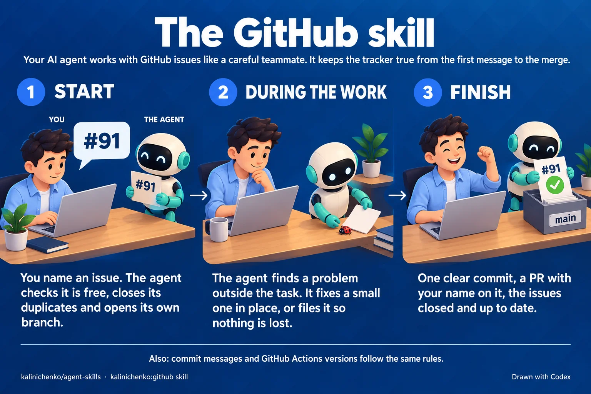
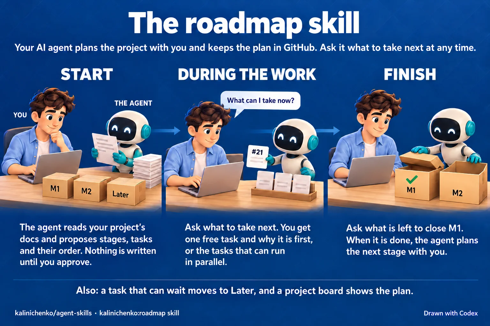

# craft-skills

> The plugin was `kalinichenko`, and this repository was `agent-skills`. If
> you installed it under the old name, [move to `craft`](docs/migrating-from-kalinichenko.md).

`craft` is a plugin for Claude Code and Codex. It gives the agent a set of
working rules and skills, so that it works on your project as a careful
engineer does: it reads the code before it writes, ships each fix with its
test, reviews its own change, and keeps the issue tracker true.

It is for a solo developer or a small team that keeps its work on GitHub.

## What it does

**The rules.** [`rules.md`](rules.md) loads at the start of every session and
every subagent. It tells the agent to run the project's own check before it
calls work done, to ship each bug fix with its test, to use the platform
before a new dependency, to move the docs with the change, and to load the
right skill at the right moment.

**The skills.** Each one loads when its moment comes. Its README says when it
starts and what you get.

- [`craft:github`](skills/github/README.md) — take an issue into work, file
  what you find outside the task, write commits and pull requests, keep the
  issues true after a merge.

  
- [`craft:roadmap`](skills/roadmap/README.md) — a project manager on top of
  GitHub: milestones, the next task, what can run in parallel, triage.

  
- [`craft:review-loop`](skills/review-loop/README.md) — a review that ends:
  rounds that read only the last fixes, a second model for risky changes, a
  security review, and a summary of what was decided and fixed.
- [`craft:product`](skills/product/README.md) — a skeptical analyst before
  the work: is the task worth doing, and is there a simpler way.
- [`craft:architecture`](skills/architecture/README.md) — new code grows into
  the project's structure, not beside it, and decisions go into ADRs.
- [`craft:debt`](skills/debt/README.md) — a map of the technical debt, filed
  as a few issues a run.
- [`craft:docker`](skills/docker/README.md) — the newest stable image, pinned
  exactly, on the smallest base that runs the app.
- [`craft:typescript-conventions`](skills/typescript-conventions/README.md) —
  house TypeScript style.
- [`craft:react-conventions`](skills/react-conventions/README.md) — layers and
  feature borders in a React app, request state, hooks and error boundaries.

## Use cases

**Take an issue into work.** Type the issue alone: `#91`. The agent checks
that nobody works on it, tells you in two or three sentences what it asks,
makes a branch and a worktree, and reads the open issues on the same code.
It does the work, runs the project's check and the review loop, opens the
pull request, and asks you whether to merge. Skills: github, review-loop.

**Review a branch before the pull request.** Ask for a review, or run
`/code-review`. The agent picks the level by the weight of the change and
says why. Each round reads only the fixes of the round before. The loop
stops at the first clean round, or after round 3. A security review and a
summary follow. Skill: review-loop.

**Plan a milestone.** Ask the agent to plan the roadmap. It reads the open
issues, proposes milestones, the order of the tasks and the links between
them, and writes them to GitHub after one yes from you. Later, ask what to
take next: you get one free task and the reason. Skill: roadmap.

## What it works with

- **GitHub**: issues, pull requests, milestones, Projects and Actions.
- **TypeScript and React**: the conventions skills.
- **Docker**: Dockerfiles, compose files and image pins.
- **Any repository with git**: the debt and architecture skills read the
  code of any language.

## Integrations

- **[superpowers](https://github.com/obra/superpowers)**: the rules send its
  review steps through `craft:review-loop`, and `craft:product` joins its
  brainstorming at a fork.
- **ponytail**: `craft:review-loop` runs its over-engineering review before
  the first round, and `craft:debt` adds its audit to the debt map.
- **Codex**: a host of its own for the plugin, and in Claude Code a second
  reviewer: it reads risky changes, specs and the text of skills.

## Dependencies

### Required

- **bash**: the hooks and every script. Without it, the rules do not load.
- **git** and **awk**: the scripts of the github, roadmap, debt and
  architecture skills.
- **`gh`**, logged in: the github and roadmap skills. Without it, the github
  skill skips each step on GitHub, and the roadmap skill stops. Both say so.

### Optional

- **The `project` scope on the `gh` token**: the board of the roadmap
  skill. Run once on each machine: `gh auth refresh -s project`. Without it,
  the roadmap has no board.
- **`npx` or `bunx`**: the copies in the debt map (`clones.sh`), with a
  `TMPDIR` that other users cannot write, or none: then it uses `~/.cache`.
  Without them, the debt map has no copies, and the report says so.
- **The Codex CLI**, logged in: the second reviewer of the review loop.
  Without it, the review goes on without Codex, and the summary says why.
- **The ponytail plugin**: the over-engineering review and audit. Without
  it, those steps are skipped, and the summary says so.
- **The superpowers plugin**: brainstorming, specs and plans. The rules work
  without it.
- **Git for Windows**, on native Windows: Claude Code runs the hooks in Git
  Bash. Without it, Claude Code runs them in PowerShell, and the rules do not
  load. Codex on native Windows is not tested: run it in WSL. `clones.sh` is
  not tested on native Windows with either tool.

## Install

The repository is its own marketplace for both tools.

Claude Code:

```sh
claude plugin marketplace add kalinichenko88/craft-skills
claude plugin install craft@kalinichenko
```

Codex:

```sh
codex plugin marketplace add kalinichenko88/craft-skills
codex plugin add craft@kalinichenko
```

Then run `codex`, open `/hooks` and trust the plugin's three hooks. Codex skips
plugin hooks until you do, so without that the skills load but the rules do
not. Editing `rules.md` does not need a new trust; changing `hooks/hooks.json`
does.

The hooks are plain bash. The two that inject the rules have no other
dependency. The third names a Claude Code session after an issue: it calls
`gh`, and in Codex it does nothing.

## Update

Claude Code tracks commits: the plugin carries no `version`, so every push is a
new one. Background auto-update is off for third-party marketplaces; turn it on
under `/plugin` → Marketplaces → `kalinichenko`, or update by hand:

```sh
claude plugin update craft@kalinichenko
```

Codex installs the plugin under the `version` in `.codex-plugin/plugin.json` and
reinstalls it when a release moves that field. It upgrades the marketplace in
the background at startup; to upgrade now:

```sh
codex plugin marketplace upgrade kalinichenko
```

## Contributing

To work on the plugin itself — the checks, the tests and the release — see
[CONTRIBUTING.md](CONTRIBUTING.md).
