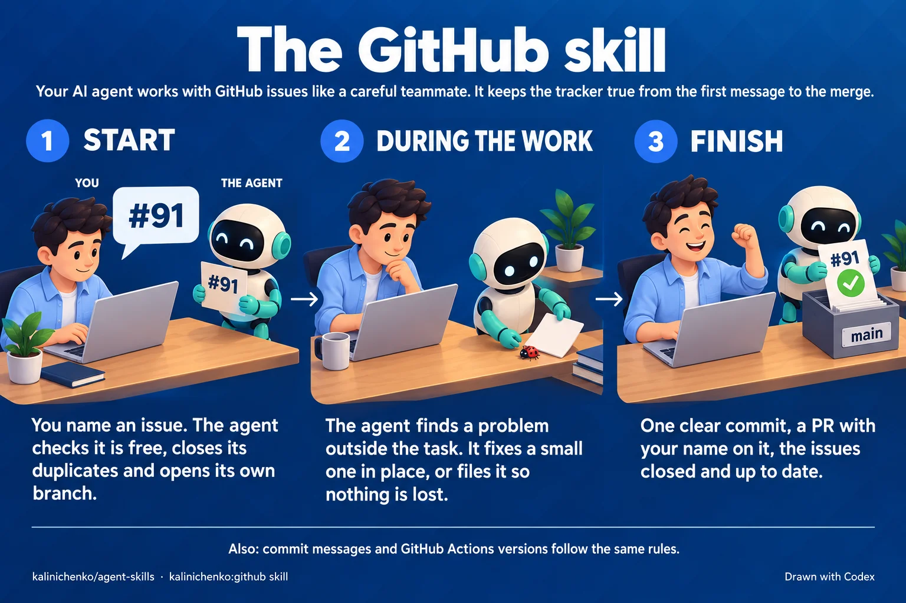

# agent-skills

One plugin, `kalinichenko`, for both Claude Code and Codex: an always-on base
prompt of engineering rules, plus the skills those rules lean on.

- **`rules.md`** — the base prompt: run the repository's own check before
  calling work done, ship every bug fix with its test, use the platform before
  a dependency, keep code and commits in English, write prose in Simplified
  Technical English, move docs with the change, verify review findings before
  acting on them. In Claude Code a Haiku subagent does the reading for two of
  them: it counts the real payloads before a bug fix, and finds the docs a
  change made false. A plugin has no slot for a `CLAUDE.md` or `AGENTS.md`, so
  `hooks/rules.sh` injects it at the start of every session and every subagent.
- **`kalinichenko:github`** — commits, pull requests, issues and Actions.

  

  An issue named on its own — `#91` or its URL — starts the work. Its duplicates
  close before the work starts, and the work gets a worktree named for what it
  does. Every open bug and debt issue in the same area is checked, so one PR
  can close them with the task. A finding joins an open issue on the same code
  before a new one is filed, up to two added findings per issue. Scripts do
  the steps with one correct result: they read the tracker into one file, add
  a finding to an issue, check an issue before it is taken, set up its
  worktree, and keep it open when a pull request fixes only part of it. In
  Claude Code a Haiku subagent reads a file of 20 KB or more, so the main
  model gets only the candidates. A Haiku subagent also checks the
  `path:line` citations in issues against the code. Each scenario step by
  step:
  [start a task](docs/github/01-start.webp),
  [find something outside the task](docs/github/02-during.webp),
  [finish the task](docs/github/03-finish.webp).
- **`kalinichenko:roadmap`** — a project manager on top of GitHub. It answers
  "what can I take now", "what can run in parallel" and "what is left to close
  M1", builds the roadmap with you from the project's `docs/`, and puts a task
  off to `Later` when you agree to. The plan lives in GitHub: milestones in
  order, "blocked by" links and sub-issues, so it cannot go stale. Scripts read
  it through the GitHub API and rank the free tasks on the main path, among
  bugs and the rest. In Claude Code a Haiku subagent reads the code to find
  which tasks would change the same functions. A GitHub Project with saved
  views, which the skill sets up, shows the plan.
- **`kalinichenko:docker`** — the newest stable image, pinned exactly, on the
  smallest base that runs the app.
- **`kalinichenko:typescript-conventions`** — house TypeScript style.
- **`kalinichenko:react-conventions`** — layer and feature boundaries in a
  React app, request state as one union, and no `ref.current` in render. Each
  rule is one that agents broke in a test without it.

The repository is its own marketplace for both tools.

## Install

Claude Code:

```sh
claude plugin marketplace add kalinichenko88/agent-skills
claude plugin install kalinichenko@kalinichenko
```

Codex:

```sh
codex plugin marketplace add kalinichenko88/agent-skills
codex plugin add kalinichenko@kalinichenko
```

Then run `codex`, open `/hooks` and trust the plugin's two hooks. Codex skips
plugin hooks until you do, so without that the skills load but the rules do
not. Editing `rules.md` does not need a new trust; changing `hooks/hooks.json`
does.

The hook is plain bash with no other dependency. The github and roadmap skills'
scripts are bash too, and they also need `gh`. On native Windows, Claude Code runs
them in Git Bash, so install [Git for Windows](https://git-scm.com/downloads/win):
without it, Claude Code runs the hook in PowerShell, and the rules do not load.
Codex on native Windows is not tested: run it in WSL.

The roadmap skill's board needs the `project` scope on the `gh` token. Run
once on each machine:

```sh
gh auth refresh -s project
```

## Update

Claude Code tracks commits: the plugin carries no `version`, so every push is a
new one. Background auto-update is off for third-party marketplaces; turn it on
under `/plugin` → Marketplaces → `kalinichenko`, or update by hand:

```sh
claude plugin update kalinichenko@kalinichenko
```

Codex installs the plugin under the `version` in `.codex-plugin/plugin.json` and
reinstalls it when a release moves that field. It upgrades the marketplace in
the background at startup; to upgrade now:

```sh
codex plugin marketplace upgrade kalinichenko
```

## Recommended lint rules

`kalinichenko:typescript-conventions` asks for a blank line before `return`. To
make ESLint enforce it in a project, add this rule from `@stylistic`:

```js
'@stylistic/padding-line-between-statements': [
  'error',
  { blankLine: 'always', prev: '*', next: 'return' },
],
```

It does not touch a `return` that is the only statement in its block.

## Develop

`make check` validates the manifests, runs shellcheck and replays `rules.md`
through the hook to prove the JSON it prints carries the file byte for byte and
stays within Claude Code's 10,000-character cap on hook context. It checks that
a checkout with `core.autocrlf=true`, the Git for Windows default, keeps every
text file in LF, that the hook still gives the rules from a CRLF `rules.md`, and
that every script starts with `#!/usr/bin/env bash`. It also runs the github and
roadmap skills' scripts against a fake `gh` that answers from payloads recorded
in `tests/fixtures/github/` and `tests/fixtures/roadmap/`, all from public
repositories.

To try a script that writes on a real tracker without writing to it, set
`DRY_RUN=1`. `GH_REPO=<owner/repo>` points `collect.sh`, `take-in-check.sh`,
`add-finding.sh` and the roadmap scripts at another repository than the
checkout's.

To try an edit in Claude Code without installing: `claude --plugin-dir .`.

The pictures in `docs/` are drawn by Codex from the brief next to them, as
`docs/github/brief.md`. To change a picture, change its brief and run
`/infographic` in Claude Code from this repository. Like `/release`, it lives
in `.claude/skills/` and does not ship with the plugin.

## Release

Pull requests leave `version` alone. Once the work is on `main`, run `/release`
in Claude Code from this repository, or `/release minor` to pick the level. It
bumps `.codex-plugin/plugin.json`, writes the `CHANGELOG.md` section, tags
`vX.Y.Z`, pushes both and publishes a GitHub release with that section as its
notes. The skill lives in `.claude/skills/`, not `skills/`, so it does not ship
with the plugin.
