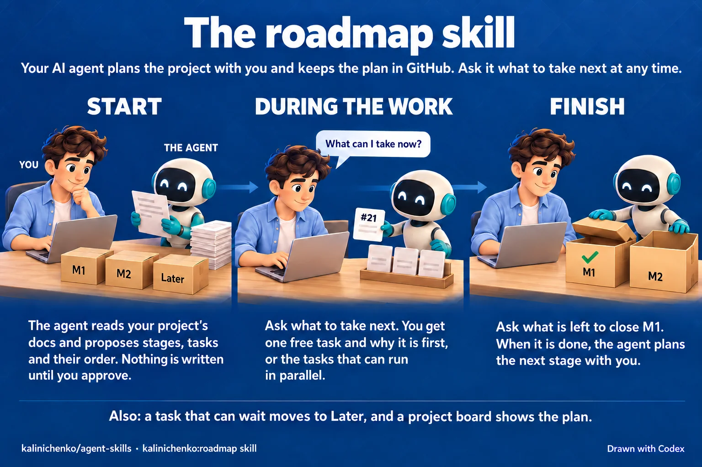

# agent-skills

One plugin, `kalinichenko`, for both Claude Code and Codex: an always-on base
prompt of engineering rules, plus the skills those rules lean on.

- **`rules.md`** — the base prompt: run the repository's own check before
  calling work done, ship every bug fix with its test, use the platform before
  a dependency, keep code and commits in English, write prose in Simplified
  Technical English, move docs with the change, verify review findings before
  acting on them and load the review loop in place of superpowers' review
  skills before the first review of a change and, in Claude Code, in place
  of the builder check of a superpowers spec and after the self-review of its
  plan,
  load the TypeScript conventions before the first write to a TypeScript file
  and the React conventions before the first write to a React component or
  hook. Outside this repository, report a defect in this plugin to its
  tracker only after the person says yes. In Claude Code a Haiku subagent
  does the reading for two of them: it counts the real payloads before a bug
  fix, and finds the docs a change made false. A plugin has no slot for a
  `CLAUDE.md` or `AGENTS.md`, so `hooks/rules.sh` injects it at the start of
  every session and every subagent.
- **[`kalinichenko:github`](skills/github/README.md)** — commits, pull
  requests, issues and Actions.

  
- **[`kalinichenko:roadmap`](skills/roadmap/README.md)** — a project manager on
  top of GitHub.

  
- **[`kalinichenko:review-loop`](skills/review-loop/README.md)** — a review
  that ends: rounds that read only the last fixes, one last pass over the
  whole branch when the loop needed more than one round, Codex as a second
  reviewer for `xhigh` changes in Claude Code, a review of the tests for
  `high` and `xhigh` changes and a change to tests only, a review against
  the project's architecture file and ADRs beside round 1, a security
  review, and a summary of what the branch changed and what was decided and
  fixed. A change to documents only gets one round and no security review.
  In Claude Code, Fable and Codex
  also read a superpowers spec, and one more subagent checks its plan
  against it.
- **[`kalinichenko:debt`](skills/debt/README.md)** — a map of the technical
  debt: hotspots, broken layer rules, copies and, with ponytail,
  over-engineering, filed as at most three `debt` issues a run, and one
  more for the rules that the instruction files repeat or contradict.
- **[`kalinichenko:architecture`](skills/architecture/README.md)** — new code
  that grows into the project's structure, not beside it: the problem before
  the code, one way to do one kind of work, a split before a file grows past
  its limit, and numbered invariants in `docs/ARCHITECTURE.md` that a script
  checks.
- **[`kalinichenko:docker`](skills/docker/README.md)** — the newest stable
  image, pinned exactly, on the smallest base that runs the app.
- **[`kalinichenko:typescript-conventions`](skills/typescript-conventions/README.md)**
  — house TypeScript style.
- **[`kalinichenko:react-conventions`](skills/react-conventions/README.md)** —
  layer and feature boundaries in a React app, where a sub-component's own
  files go, request state as one union, a hook for each of a component's two
  jobs, no `ref.current` in render, and an error boundary at the app level and
  at each route.

Each skill's README says when it starts and what you get. The github and
roadmap READMEs show each scenario as a picture.

The repository is its own marketplace for both tools.

## Install

Claude Code:

```sh
claude plugin marketplace add kalinichenko88/agent-skills
claude plugin install kalinichenko@kalinichenko
```

Codex:

```sh
codex plugin marketplace add kalinichenko88/agent-skills
codex plugin add kalinichenko@kalinichenko
```

Then run `codex`, open `/hooks` and trust the plugin's three hooks. Codex skips
plugin hooks until you do, so without that the skills load but the rules do
not. Editing `rules.md` does not need a new trust; changing `hooks/hooks.json`
does.

The hooks are plain bash. The two that inject the rules have no other
dependency. The third names a Claude Code session after an issue: it calls
`gh`, and in Codex it does nothing. The github and roadmap
skills' scripts are bash too, and they also need `gh`, git and awk. The
debt skill's `measure.sh` needs only bash, git and awk; its `clones.sh`
also needs `npx` or `bunx`,
and a `TMPDIR` that other users cannot write, or none: then it uses
`~/.cache`. The architecture skill's `invariants.sh` needs only bash, git and
awk. On native Windows, Claude Code runs
them in Git Bash, so install [Git for Windows](https://git-scm.com/downloads/win):
without it, Claude Code runs the hook in PowerShell, and the rules do not load.
Codex on native Windows is not tested: run it in WSL. The debt skill's
`clones.sh` is not tested on native Windows with either tool.

The roadmap skill's board needs the `project` scope on the `gh` token. Run
once on each machine:

```sh
gh auth refresh -s project
```

## Update

Claude Code tracks commits: the plugin carries no `version`, so every push is a
new one. Background auto-update is off for third-party marketplaces; turn it on
under `/plugin` → Marketplaces → `kalinichenko`, or update by hand:

```sh
claude plugin update kalinichenko@kalinichenko
```

Codex installs the plugin under the `version` in `.codex-plugin/plugin.json` and
reinstalls it when a release moves that field. It upgrades the marketplace in
the background at startup; to upgrade now:

```sh
codex plugin marketplace upgrade kalinichenko
```

## Develop

`make check` validates the manifests, runs shellcheck, checks the invariants of
`docs/ARCHITECTURE.md` with the architecture skill's `invariants.sh`, and
replays `rules.md` through the hook to prove the JSON it prints carries the file
byte for byte and stays within Claude Code's 10,000-character cap on hook
context. It checks that a checkout with `core.autocrlf=true`, the Git for
Windows default, keeps every text file in LF, that the hook still gives the
rules from a CRLF `rules.md`, that every script starts with
`#!/usr/bin/env bash`, and that every `- ` line of `CHANGELOG.md` starts with
its scope in parentheses. It also runs the github and roadmap skills' scripts
against a fake `gh` that answers from payloads recorded
in `tests/fixtures/github/` and `tests/fixtures/roadmap/`, all from public
repositories, the debt skill's `measure.sh` on a repository the test builds,
and its `clones.sh` against a fake `npx` that answers with a report recorded
from `jscpd` for the tree in `tests/fixtures/debt/`, and with a fake `bunx`
when `bun` is installed. Without `node`, the test skips `clones.sh` and says
so. One case runs `clones.sh` with no `TMPDIR`, so it makes and removes a
directory in your `~/.cache`. The review-loop skill's `codex-review.sh` runs
against a fake `codex` that answers with findings recorded from `codex exec`
on this repository, in `tests/fixtures/review_loop/`. The session-title
hook runs on prompts recorded from Claude Code and Codex, in
`tests/fixtures/hooks/`, against a fake `gh`. The architecture skill's
`invariants.sh` runs on repositories the tests build: each kind of check, the
`debt` lists, `--new-since` over renamed files, changed checks and a base
file that it cannot read, and the calls that must stop with exit 2.

`make check` runs every `tests/<name>_test.sh`. A test passes only when it
exits 0 and its last non-empty line on stdout is `<name>_test: ok`: under bash
3.2, a script that `set -u` stops exits 0 when it has an EXIT trap.
`tests/makefile_test.sh` checks this rule. A new test script ends with its `ok`
line.

GitHub Actions runs `make check` on each pull request and each push to `main`
(`.github/workflows/check.yml`). It runs on Ubuntu 26.04, with its ShellCheck
0.11.0 and with `mawk` as `awk`; `make check` on macOS runs BWK awk. A second
job runs gitleaks on the new commits. The eval scripts below call the model, so
they do not run there.

A skill script that sets an EXIT trap under `set -u` empties `finished` before
the trap and sets `finished=1` at each end that succeeds. Its trap turns an exit
status of 0 without that flag into 1: bash 3.2 runs the trap with `$?` at 0 when
`set -u` stops the script. `clean` in `skills/github/scripts/collect.sh` shows
the shape.

To try a script that writes on a real tracker without writing to it, set
`DRY_RUN=1`. `GH_REPO=<owner/repo>` points `collect.sh`, `take-in-check.sh`,
`add-finding.sh` and the roadmap scripts at another repository than the
checkout's.

To try an edit in Claude Code without installing: `claude --plugin-dir .`.

`tests/skill_load_eval.sh` counts the Haiku subagents that load the conventions
skills, the files they write with an implicit return in a method callback, as
`.map((x) => (`, the runs with a file that opens with a helper or a constant
instead of its primary export, the runs that put the order, its line, the
customer or the discount outside `models/` or two of them in one file, and the
runs whose discount file opens with its variants instead of the union. It
counts the runs that keep a 30-line table of decline messages out of
`constants.ts`, or put their short fallback message in it. In every task, it
counts the runs that name a module-level `const` with a literal value in
camelCase, or any other `const` in CONSTANT_CASE. In a
React feature, it counts the runs that put a sub-component's own hook at the
feature root or in `shared`, and the runs with a zod schema outside
`schemas/`. In the three React tasks, it counts the runs with a component or a
hook that holds two requests or more: a comments section loads and sends
comments, and the other two tasks have one request each. With
`--check <logs folder>` it runs only these checks, on the logs that an earlier
run printed. `tests/skill_load_checks_test.sh` runs them so in `make check`,
on `tests/fixtures/skill_load`: four recorded runs and a case that fails each
check. A change to a check updates the output that the test expects.
`tests/review_loop_eval.sh` counts the review rounds and what each one reads.
It checks that no count of rounds goes past three, that the review of the
tests runs once next to the last pass and never without one, that the
review of the architecture runs once before round 2, and that a security
review follows the last pass, in a subagent and not in the session. Its
fixture has a local `origin` and an architecture file, and its task says
that no one can answer questions. Run it after a change to
`skills/review-loop` or to its section in `rules.md`.
`tests/review_loop_lens_eval.sh` sends the review of the architecture to six
branches of one fixture: a second HTTP client, a `fetch` call that breaks an
invariant, the same call with an ADR that amends it, a base that breaks it
already, a folder with no code file added to the `Check:` line of an
invariant, and that folder taken out again on a base where a second
invariant names one too. With `--codex`, Codex reads the six branches with
the same prompt. Run it after a change to
`skills/review-loop/architecture-lens.md` or to the parts of
`skills/architecture/SKILL.md` that it reads.
`tests/debt_lens_eval.sh` sends the review of the instruction files to a
monorepo whose `CLAUDE.md` files repeat and contradict its architecture file
and each other. It checks each repeat, contradiction, redundancy and
citation of the fixture, that the Environment section, which has no copy,
gets no finding, and that a symlink and a pair of `CLAUDE.md` and
`AGENTS.md` of one folder are no repeat. With `--codex`, Codex reads it with
the same prompt. Run it after a change to `skills/debt/instructions-lens.md`.
`tests/architecture_eval.sh` gives three tasks to Opus in a shop whose one
module wraps every HTTP call, in four arms: no architecture file and no
skill; the file and a link from `CLAUDE.md`; the same and the skill; the same
and the `CLAUDE.md` line. It counts the runs that use the wrapper, write the
block of *The start of a feature*, write one ADR for a new data store, split
a file past its limit in a commit before the feature, and load the skill
before the first write. It also counts how often `haiku` and `sonnet` find
the code that a task can use. Run it after a change to the description of
`kalinichenko:architecture`. `tests/architecture_checks_test.sh` runs its
checks in `make check`, on `tests/fixtures/architecture`: one recorded run,
and a case for each verdict that the run does not show. It also runs the eval
once with a stub `claude` in the place of the model.
`tests/review_loop_lens_checks_test.sh` checks that the lens eval refuses a
wrong call before it starts a paid run.
The four `_eval.sh` scripts call the model, so their runs are not part of
`make check`.

The pictures in `docs/` are drawn by Codex from the brief next to them, as
`docs/github/brief.md`. To change a picture, change its brief and run
`/infographic` in Claude Code from this repository. Like `/release`, it lives
in `.claude/skills/` and does not ship with the plugin.

## Release

Pull requests leave `version` alone. Once the work is on `main`, run `/release`
in Claude Code from this repository, or `/release minor` to pick the level. It
bumps `.codex-plugin/plugin.json`, writes the `CHANGELOG.md` section, tags
`vX.Y.Z`, pushes both and publishes a GitHub release with that section as its
notes. The skill lives in `.claude/skills/`, not `skills/`, so it does not ship
with the plugin.
