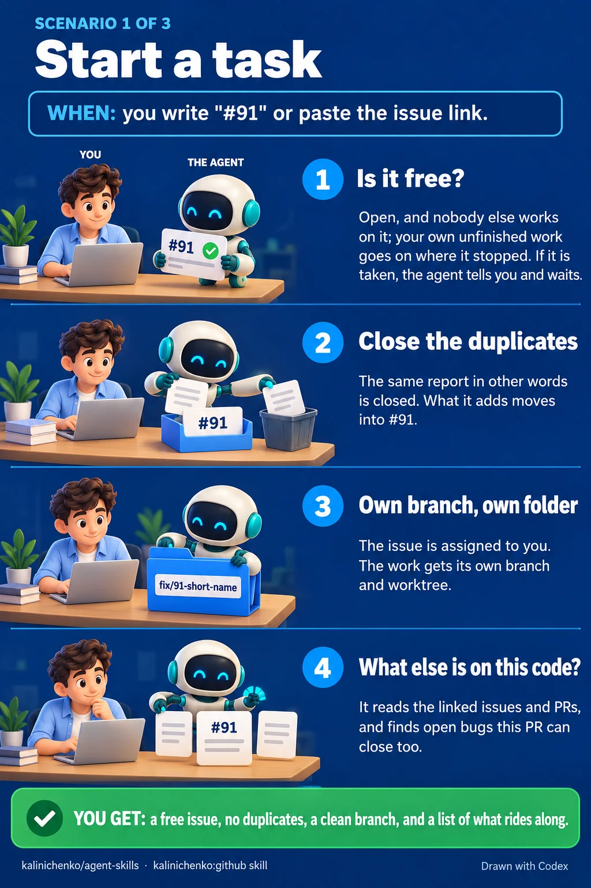
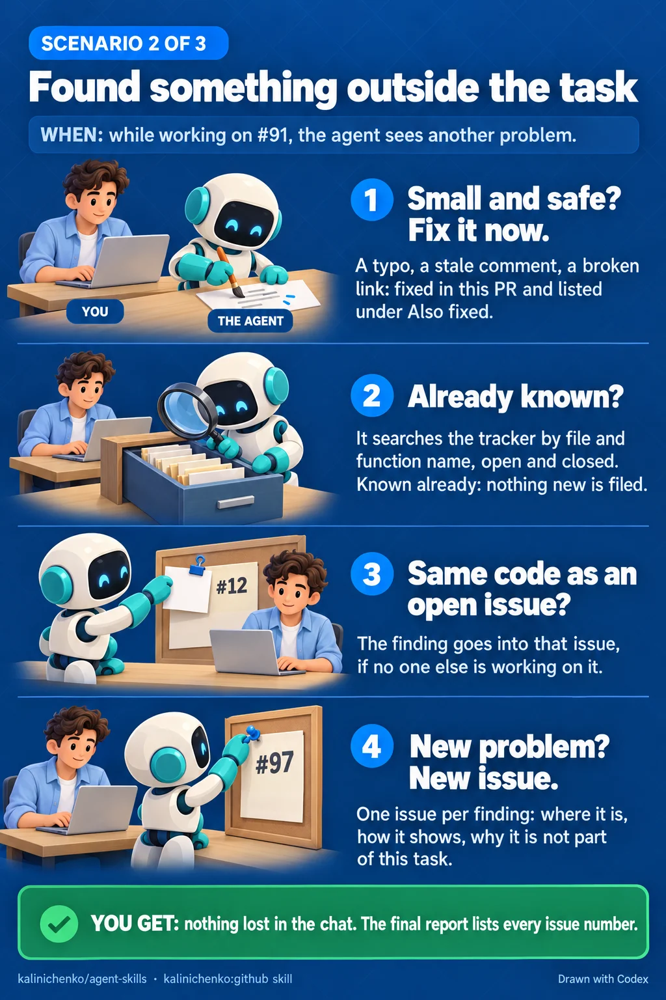
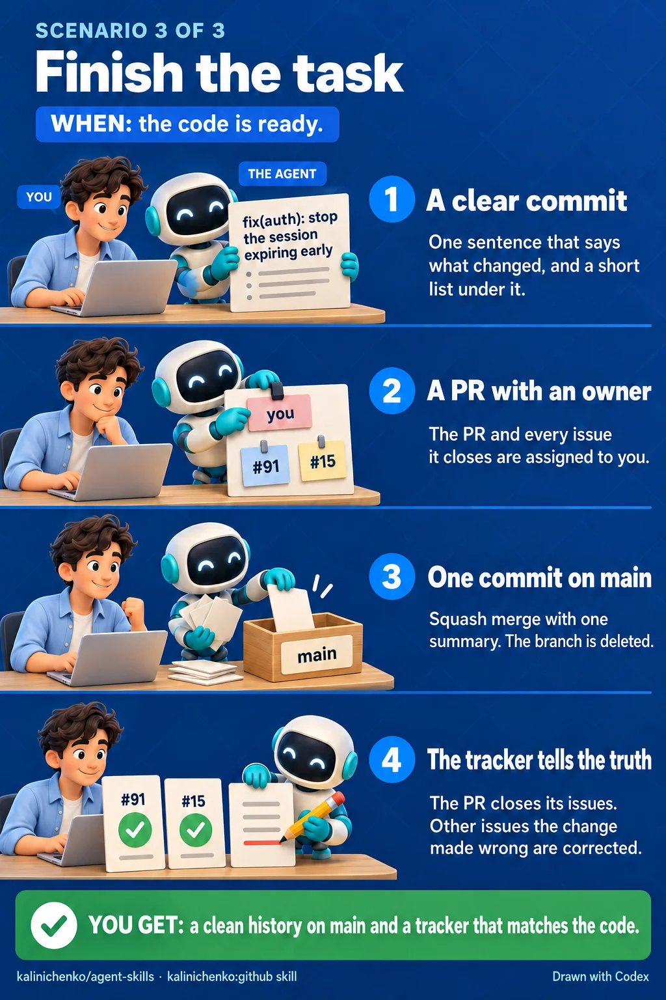

# kalinichenko:github

Commits, pull requests, issues and GitHub Actions, done the same way every
time.

## When it starts

- You write a commit message, open a pull request or merge one.
- You name an issue on its own — `#91` or its URL — to start work on it.
- You find something worth fixing that is outside the task.
- You check whether a finding is already filed.
- A rule, a skill or a script of this plugin is wrong.
- You create or edit a GitHub Actions workflow.

## What you get

- **A task starts clean.** When you name an issue, the agent first tells you
  its number, its title and, in two or three sentences, what it asks. In
  Claude Code, when your message is the issue alone, the session takes the
  issue's number and a short form of its title as its name: the number and
  the title's first part, whole up to 50 characters, else cut to 40. Its
  duplicates close before the work starts. The work gets a worktree
  named for what it does, as `fix/91-what-it-does`. Every open bug and debt
  issue in the same area is checked, so one PR can close them with the task.
  Name an issue of yours again, as after you closed the terminal: when the
  branch it has on GitHub is here with its last commit, the work goes on
  there, with no question. In Claude Code, the agent first looks for a session
  still open under the issue's name, and stops when it finds one.
- **A finding goes to the tracker, not to the chat.** A fix in the task's
  module that needs no decision and is smaller than the task goes into the
  current PR. Anything else joins an open issue on the same code, up to two
  added findings per issue. Only when no issue can take it is a new one filed.
- **A defect in the plugin reaches its tracker.** When the agent finds that
  a rule, a skill or a script of this plugin is wrong, it writes an issue for
  `kalinichenko88/agent-skills`: the plugin version, the file and line, and
  the steps that show it again, with neutral names. In a checkout of
  `agent-skills`, the defect is an ordinary finding. Anywhere else, the agent
  shows you the issue and files it only after you say yes. Nothing from your
  project goes in.
- **A task runs to its pull request.** After the review, the agent runs the
  repository's check on the final branch. When it passes and the branch is
  not the default branch, the agent pushes, opens the PR and shows the exact
  merge command, in the same turn. In a worktree, it asks one question: merge
  and clean up, merge only, or do not merge. After a stop at round 3, more
  rounds is one more answer. Clean up removes the worktree
  and the local branch after the merge, when nothing in them would be lost.
  Only the merge and the open questions on business logic wait for you.
- **A task finishes with a true tracker.** The PR and every issue it closes
  are assigned to you. A PR that fixes only part of an issue keeps that issue
  open. After the merge, the `path:line` citations in open issues are checked
  against the new code.
- **Commits in one shape.** `type(scope): sentence`, at most five bullets
  under it, and no `Co-Authored-By:` trailer. A merge is a squash with one
  list for the whole branch.
- **Nothing private in a public repository.** Before an issue, a comment, a
  PR, a branch or a commit goes out, the agent reads the visibility of the
  repository that gets it. In a public one, a case from a private source — a
  private repository, a work tracker, a chat — goes in with counts and
  neutral names: "a private tracker with 100 open issues", not its name,
  numbers, titles, paths, code or people.
- **Actions on the latest major.** Each `uses:` is checked against the GitHub
  API. The language runtime in CI is not older than the one on your machine.

## Each scenario step by step

### Start a task

### Found something outside the task

### Finish the task

## How it works

Scripts in `scripts/` do the steps with one correct result. They read the
tracker into one file, check an issue before it is taken, set up its
worktree, add a finding to an issue, and keep an issue open when a PR fixes
only part of it. In Claude Code a Haiku subagent reads a tracker file of
20 KB or more, so the main model gets only the candidates. A Haiku subagent
also checks the `path:line` citations in issues against the code.

## Needs

`bash`, `git`, `awk` and `gh`, authenticated against a GitHub remote.
Without them, the skill skips its GitHub steps and says so. A defect in this
plugin needs only `gh` logged in to github.com. Without it, you get the draft
of the issue and a link to file it by hand.
