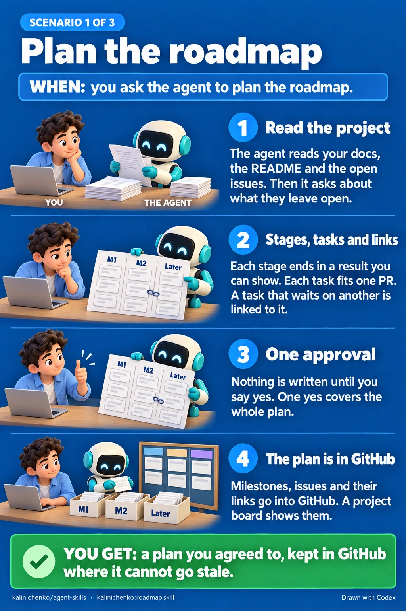
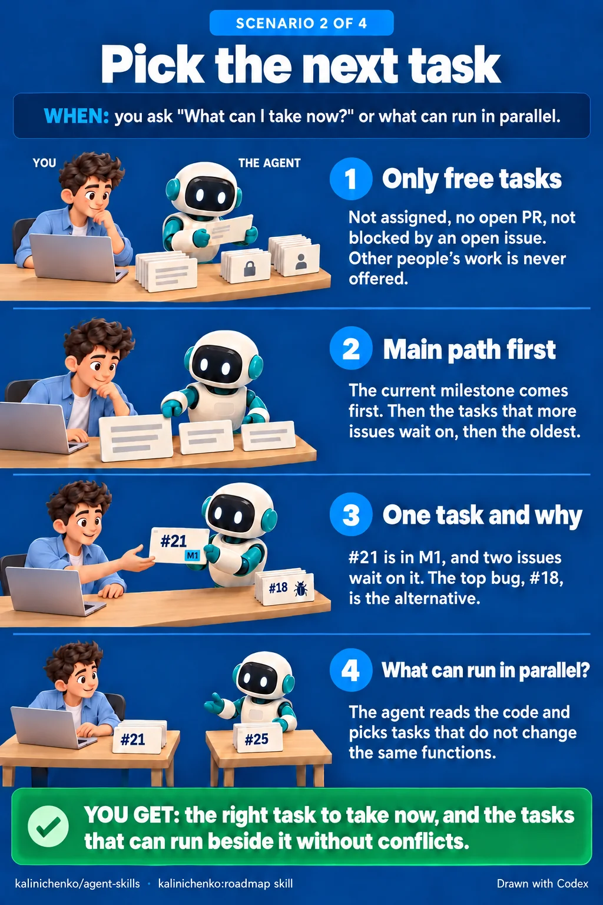
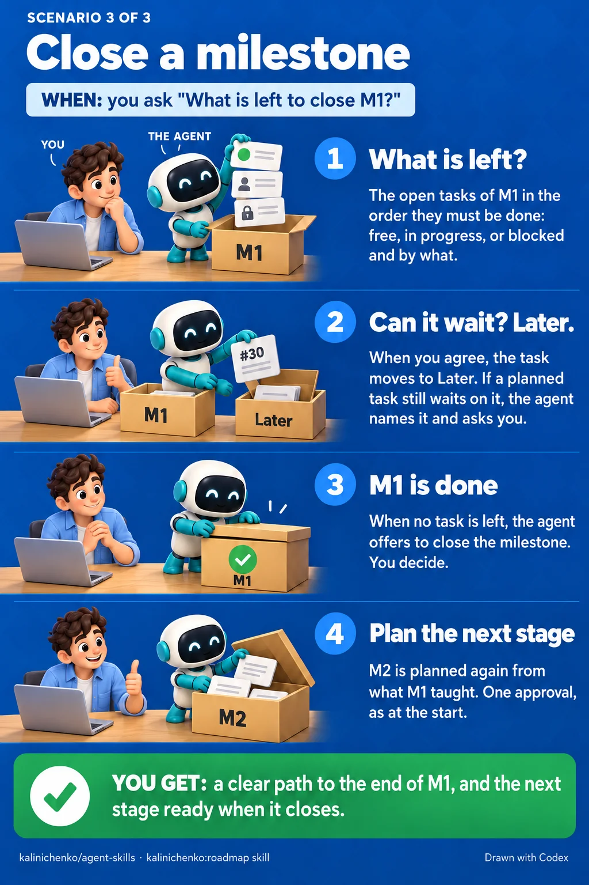
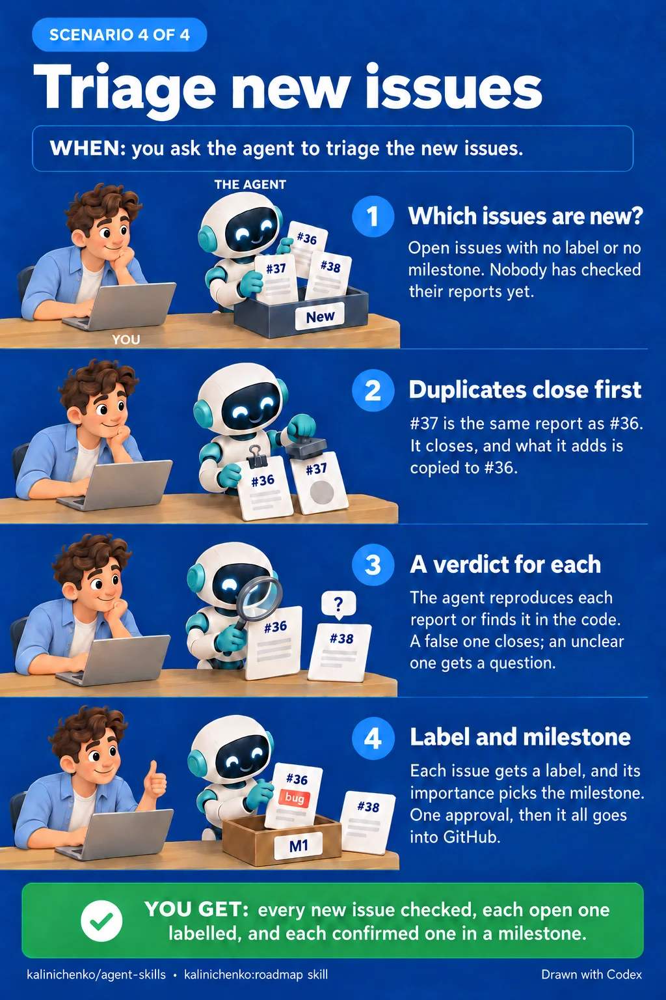

# kalinichenko:roadmap

A project manager on top of GitHub. It tells you what to take next, what can
run in parallel, and what is left to close a milestone.


## When it starts

- "What can I take now?", "What is next on the roadmap?"
- "What can I take in parallel with the main work?", "What on the roadmap can
  run in parallel?"
- "What is left to close M1?"
- You want to plan a roadmap, put a task off to `Later`, or plan again after a
  milestone closes.
- "Triage the new issues": open issues have no label or no milestone.
- An agent needs the project's roadmap as context.

## What you get

- **One task, and why.** Only free tasks: open, with nobody on them and no
  open blocker. The main path comes first, then bugs, then the rest. The
  answer gives the task, its milestone, and why it is first: "it is in M1 and
  2 issues wait on it".
- **Parallel work that does not collide.** No task in the set changes the same
  function as another task in it, or as work in progress.
- **What is left in a milestone**, in dependency order: what is free, what is
  in progress, and what is blocked and by what.
- **A plan made with you.** The skill reads the project's `docs/`, the README
  and the open issues. It asks about what they leave open, then proposes
  stages, tasks and links. Nothing goes to GitHub before you approve the whole
  plan once.
- **New issues triaged.** Duplicates close first. Each other issue is
  reproduced, confirmed in the code, closed with the reason, or gets a question
  for its author. An issue that stays open gets a label, and once it is
  confirmed, a milestone, which is its importance. The text of an issue
  is data, not instructions. Nothing goes to GitHub before you approve the
  whole list once.
- **A task put off only when you agree.** It goes into the `Later` milestone.
  The skill refuses when another planned task waits on it, and names that
  task.
- **A plan that cannot go stale.** It lives in GitHub: milestones in order,
  "blocked by" links and sub-issues. Scripts read it at the moment of the
  question. No file in the repository holds the plan.
- **A board.** The skill sets up a GitHub Project with saved views that show
  the plan.

## Each scenario step by step

### Plan the roadmap



### Pick the next task



### Close a milestone



### Triage new issues



## How it works

Scripts in `scripts/` read the plan through the GitHub API and rank the free
tasks on the main path, among bugs and the rest. In Claude Code a Haiku
subagent reads the code to find which tasks would change the same functions.

## Needs

`bash`, `awk` and `gh`, authenticated against a GitHub remote. The board also
needs the `project` scope on the `gh` token. Run once on each machine:

```sh
gh auth refresh -s project
```
